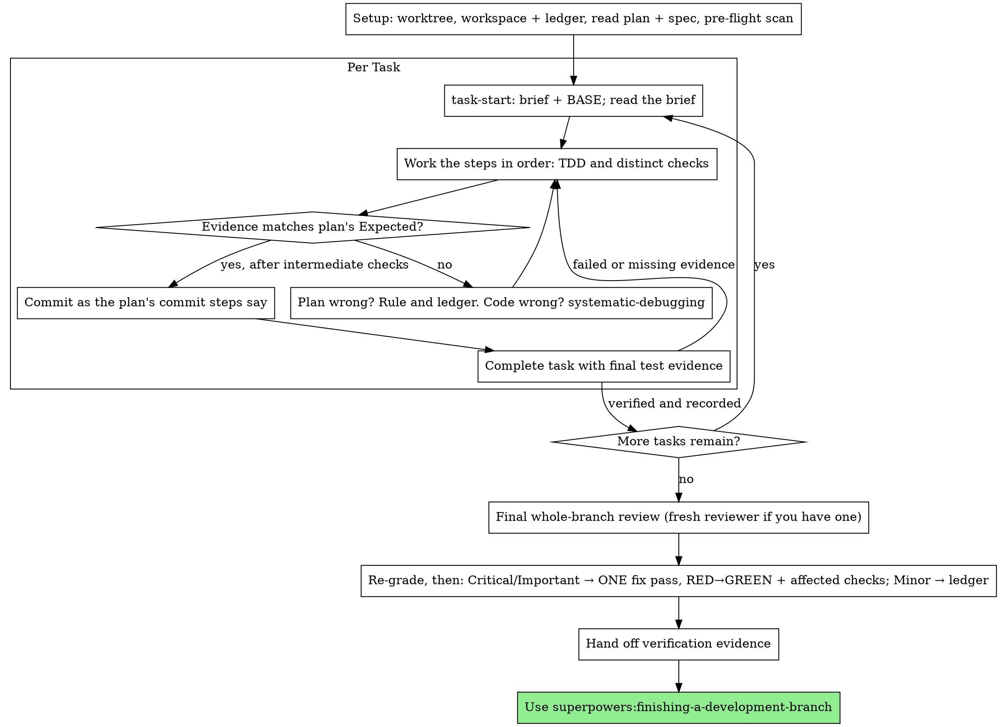

# Executing Plans

Execute the plan yourself, task by task, in this session: no implementer
subagent per task, no reviewer per task. One fresh-context review of the
whole branch at the end.

**Why inline:** Subagent-driven development pays for a fresh implementer
and a fresh reviewer on every task, each re-reading the codebase from zero.
Inline execution pays for one context (yours) plus one reviewer at the end.
What it gives up is a fresh context per task and a second pair of eyes per
task. This skill keeps what those two things bought, by other means: the
brief is the spec, the ledger is your memory, TDD is the per-task gate, and
the final reviewer is the second pair of eyes.

**Core principle:** Follow the plan, prove changes with RED→GREEN where
required, and leave verification evidence the next stage can use.

**Narration:** between tool calls, narrate at most one short line — the
ledger and the tool results carry the record.

**Continuous execution:** Do not pause to check in with your human partner
between tasks. They chose inline execution to spend less, not to answer
"should I continue?" after every task. Execute all tasks from the plan
without stopping.

**Rulings, not stalls.** Conflicts, ambiguities, plan defects — decide them.
The spec is the binding authority, the plan is its argument, and your
judgment settles what neither answers. Record every decision in the ledger
as `Ruling: <what you decided> — <why> — <what it costs if wrong>`, and keep
going. Deviating from the plan without a ledgered ruling is a decision made
in secret.

Four things stop you, and only these: an irreversible or destructive
operation; a security-sensitive action; a side effect outside this worktree
that norms say you ask about first (a merge, a push to a shared branch, a
publish); and a plan so broken that every path forward is a guess. For
those, stop and ask.

## When to Use

- You have a plan from superpowers:writing-plans and your human partner
  chose inline execution at the handoff.
- Your harness has no subagent tool (see the per-platform references in
  `../using-superpowers/references/`). Never fabricate a dispatch; run
  the plan here.
- Tasks are mostly independent — the same precondition as
  superpowers:subagent-driven-development.

A fully specified plan makes inline execution transcription plus testing:
it runs well on a mid-tier session model, and the one place the most
capable model earns its cost is the final review, which this skill
dispatches separately. Tell your human partner so when they choose inline.

Prefer superpowers:subagent-driven-development when your human partner
wants a review gate on every task, or when the plan is long enough that
its later tasks would run on a compacted context. Inline execution over a
long plan still works — the ledger is what makes it recoverable — but the
last tasks get the least of you.

## The Process

## Setup

Ensure the work happens in an isolated workspace: use
superpowers:using-git-worktrees to create one or verify the existing one.
Never start implementation on a main/master branch without your human
partner's explicit consent.

Conversation memory does not survive compaction. An inline executor that
loses its place re-implements tasks whose commits already exist — the same
failure as a controller re-dispatching them, paid for in your own context.
Track progress in a ledger file, not only in todos. Harness todos are a
live view; the ledger is the record.

The workspace and ledger are shared with superpowers:subagent-driven-development
— same directory, same format — so a plan can change executors mid-flight
and the new one resumes from the same ledger.

- Each plan owns a workspace: at skill start, run
  `bash ../subagent-driven-development/scripts/sdd-workspace PLAN_FILE` by its
  absolute path, from the working tree you're executing in — it
  prints the plan's git-ignored directory
  (`<repo-root>/.superpowers/sdd/<plan-basename>/`), home to every
  artifact for THIS plan: ledger, briefs, review packages. Another plan's
  directory is never yours to read or write.
- Check for this plan's ledger at `<workspace>/progress.md`. If it exists,
  use [the shared resumption rules](../subagent-driven-development/references/resuming.md)
  to reconcile completed tasks with their latest evidence. Preserve their
  commits and pick up at the first unfinished task or unresolved check.
- Create the ledger with its identity as the first line:
  `# SDD ledger — plan: <plan file path>`.
- `git clean -fdx` will destroy the workspace (it's git-ignored scratch);
  if that happens, recover from `git log`.

Read the plan once, note its context and Global Constraints, and create a
todo per task. If the plan names a Spec, read that too: the spec is the
authority the plan argues from, and conflicts inside the plan resolve
against it. A plan with no reachable spec gets a ledger note saying so —
rulings made without one are provisional.

**REQUIRED SUB-SKILL:** load superpowers:test-driven-development now,
before Task 1. It governs every step of every task below; a plan whose
steps already say "write the failing test first" does not exempt you
from reading it.

Before Task 1, scan the plan for conflicts between tasks. The plan's
Interfaces blocks tell you where to look: for every task that consumes
what an earlier task produces, one ledger row — the two tasks, what one
produces against what the other consumes, and what you found. Tasks that
share nothing get no row; a plan whose tasks share nothing gets the single
line `Pre-flight: no shared interfaces`. Rule on each conflict a row
surfaces with the spec as the binding authority, record the ruling beside
its row, and start Task 1. Each task's own text is checked when you read
its brief, not here.

## The Task Loop

Everything you print, and every tool result, stays resident in your
context for the rest of the session. Redirect long test output to a file
in the workspace and read its tail; read a brief, not the whole plan.

### 1. Take the task

- Run this skill's `bash scripts/task-start PLAN_FILE N` by its absolute path,
  from the working tree you're executing in. It prints the brief
  path and BASE (the commit the task's range is cut from) in one call.
  Read the brief for every task, including ones you remember from setup:
  what you remember is a summary, the brief has the exact values,
  signatures, and test cases.
- Mark the task's todo in_progress.

Every tool call is a turn that re-reads your whole context. Bookkeeping
rides along with work — a ledger append in the same call as the commit,
never in a call of its own.

### 2. Work the steps

The plan's steps are already in RED-GREEN order; follow them in that
order under superpowers:test-driven-development, loaded at setup. A test
step's code is written first and run first. Watching it fail is a step,
not a formality — a test that passes before the implementation exists is
a finding about the test.

Compare each step's `Expected:` line with real output. Run distinct checks
at the relevant step, including required RED and GREEN runs. When a repeated
verification has equivalent passing evidence, refer to that output using
superpowers:verification-before-completion. Run the final task command
through `task-done` on its first final invocation (see below). Three
outcomes for a check:

- **Matches.** Next step.
- **The code is wrong.** Use superpowers:systematic-debugging. Find the
  cause; never patch the symptom to make the step's output match.
- **The plan is wrong** — a step contradicts the spec, an interface from an
  earlier task doesn't match what this task consumes, a command that
  cannot work. Rule on the smallest change that satisfies the spec, ledger
  it as `Task <N>: Ruling: <finding> — <what you decided and why>`, and
  continue. The ruling is carried, not remembered: later tasks that touch
  the same interface read it from the ledger.

Commit as the plan's commit steps say. A task that spans several commits
is fine; BASE is what the review range is cut from, never `HEAD~1`.

### 3. The completion contract

Before marking a task complete, confirm all of the following against real
output:

- The tests the brief requires exist and have evidence for their required
  outcomes, including RED→GREEN where applicable.
- The final task check passed. The ledger points to the command, result
  and supporting evidence.
- Every `Expected:` line in the brief was compared against real output.
- Every deviation from the brief has a `Ruling:` line in the ledger.

**REQUIRED SUB-SKILL:** superpowers:verification-before-completion governs
the claim. If any item is missing, the task is not complete: finish it.

### 4. Complete the task

Route the first run of the brief's final task command through this skill's
`bash scripts/task-done PLAN_FILE N BASE -- <test command>` by its absolute
path, from the working tree you're executing in. When the last planned
check is that final command, use `task-done` to run it once and compare its
output with the plan's `Expected:` line. The command must exit nonzero if
its required assertions fail. The helper keeps the full output and evidence
record for each attempt in the workspace, prints the tail and evidence path,
and appends this completion line only on success:

`Task <N>: complete (commits <base7>..<head7>, tests: <command> → <result>)`

The helper links the evidence in the ledger. Record any scope or relevant
environment details the evidence does not establish. You can supply a
non-secret target label via `SUPERPOWERS_TEST_ENVIRONMENT`.
A failing run keeps its evidence and leaves the task incomplete. If the
final command already ran in CI or at a required earlier step, such as
GREEN before a commit, read its evidence and confirm it still applies under
superpowers:verification-before-completion. Use that passing result for the
same ledger completion format and include an evidence pointer alongside
it. Once the completion contract is met, mark the todo complete.

## Final Review

Run `bash ../subagent-driven-development/scripts/review-package PLAN_FILE MERGE_BASE HEAD`
by its absolute path, from the working tree you're executing in (MERGE_BASE = the commit the branch started from, e.g.
`git merge-base main HEAD`) and review from the file it prints.

Focus the final review on changed behavior, how the tasks integrate, and
open risks. Include the task evidence and log paths with the review
package. Read applicable results and identify gaps in coverage. Use focused
checks for those gaps under superpowers:verification-before-completion.
Carry the results forward to finishing.

**With a subagent tool:** dispatch the reviewer on the most capable
available model — the whole-branch review is a judgment task — using
superpowers:requesting-code-review's
[code-reviewer.md](../requesting-code-review/code-reviewer.md), with the
package path, the plan and spec paths, the plan's Review Focus section
verbatim if it has one (the input classes and failure modes the plan's
tests do not exercise — the reviewer checks each deliberately), and a
pointer to the ledger's `Ruling:` lines so it can weigh the calls you
made. Specify the model
explicitly; an omitted model inherits the session's, which may not be the
most capable. This is the one fresh context the whole run buys. Do not
skip it, and do not replace it with your own read of the diff.

**Without a subagent tool:** read code-reviewer.md and perform that review
yourself against the package, as a separate pass after the last task's
ledger line. Write `Final review: self-review (no subagent tool)` to the
ledger, and say so in your final message: a self-review by the author is
weaker than a fresh reviewer, and your human partner decides whether that
is enough before merge.

Sort the findings before you act on any of them. The reviewer's severity
labels are advice; the gate is yours. Its "Declined to judge" list is
yours too: every line there is a ruling you make and ledger, exactly like
a plan conflict — `Final: Ruling: <behavior the reviewer set aside> —
<what a reasonable person using this software gets, and why that stands
or why it is now a finding> — <cost if wrong>`. Re-grade first, by effect: the
spec is a vision document, and a finding's grade is what a reasonable
person using this software gets if it ships, not whether the spec names
the input that triggers it — a reviewer who set a finding at Minor
because the spec was silent has graded the spec, not the effect. Then:

- **Critical and Important** enter the fix pass.
- **Minor** goes to the ledger as `Final: minor (deferred): <one-liner>`
  and to your final message under "Deferred minors". Minors never enter
  the fix pass, and never become rulings — a ruling is a decision about a
  conflict, not a note that you declined a polish suggestion.

Fix the Critical and Important findings yourself — you are the
implementer here — in ONE pass. Each fix is verified by TDD, not by a
second reviewer: write the test that reproduces the finding, watch it
fail, and make it pass. After the fixes, verify the workflows and
dependencies they affected, reusing applicable GREEN evidence. Run a full
suite when explicitly required or when narrower checks cannot cover the
affected behavior. Record each fix in the ledger as
`Final: fixed <finding> — <test name> RED→GREEN, <evidence pointer>`.
Carry the evidence from this fix pass into finishing.

A finding you decide not to fix is a ruling — `Final: Ruling: <finding> —
<why the code stands> — <cost if wrong>` — and reaches your human partner
in the rulings list. There is no second fix pass.

## Finish

Before you delete anything, collect every ledger line containing
`Ruling:` into your final message under "Rulings I made", in the order you
made them, each with what it costs if wrong, and every `minor (deferred)`
line under "Deferred minors". Both lists are exhaustive. Your final
message is the only place the decisions you took on your human partner's
behalf — and the findings you chose not to act on — reach them.

Pass the applicable verification evidence to
superpowers:finishing-a-development-branch, including results for any
startup health, core workflow and test-data cleanup checks already run.
Before deleting the plan workspace or removing its worktree, preserve the
evidence record and full log in an accessible handoff, CI result or retained
artifact. The evidence identifies the tested scope, code state, command,
environment and outcome. If the original files are the only accessible
copy, retain them until finishing and any later consumer have used them.
After a clean final review and committed fixes, delete only this plan's
workspace once this handoff condition is met.

## Common Rationalizations

| Excuse | Reality |
|--------|---------|
| "I remember what Task N says" | You remember a summary. The brief has the exact values. Read it. |
| "The plan's code is right, skip watching the test fail" | A test you never saw fail proves nothing. It is one step. Run it. |
| "The final check will cover every intermediate step" | Keep distinct expected outcomes and required RED→GREEN evidence. Use one run for equivalent checks. |
| "The plan is wrong here, I'll just do the right thing" | Do the right thing and ledger the ruling. Unledgered deviation is a decision made in secret. |
| "I'll write the ledger lines after a few tasks" | Compaction does not wait for a convenient moment. One line per task, in the same message as the commit. |
| "Let me check in before the next task" | They chose inline to spend less. Progress prompts spend their time instead. Only the four stops stop you. |
| "I read my own diff carefully; the final reviewer is redundant" | Same author, same blind spots. The reviewer is the only fresh context this run buys. |
| "Tests should pass, the change was trivial" | "Should" is not evidence. The contract requires the command and its output. |
| "Subagents are slow and expensive, I'll skip the final review too" | Inline already removed the per-task reviewers. One review of the whole branch is the floor, not the ceiling. |
| "The reviewer said Minor, so it's Minor" | The label graded the spec's silence. Grade what the person gets. Re-grade, then gate. |
| "The fix is obvious, no need for a failing test first" | The failing test is the only proof the finding was real and is now gone. Without it you have a diff and a hope. |
| "I'll fix the minors too while I'm in there" | Each extra change widens the scope you must verify. Ledger the minors for your partner. |
